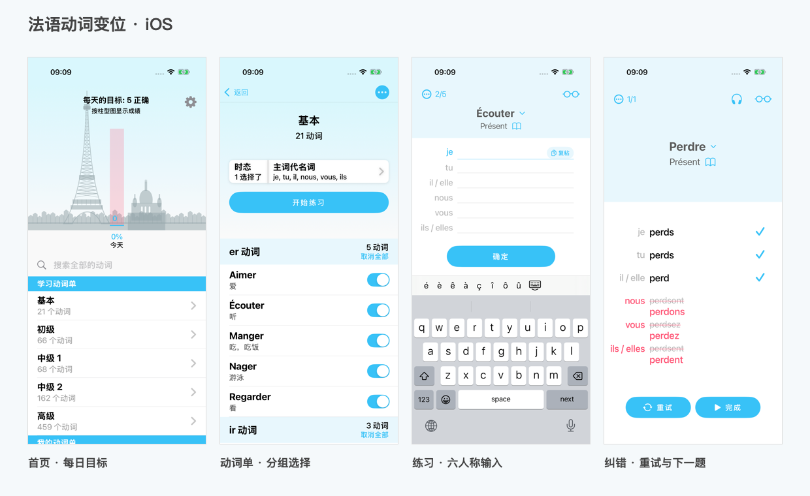

# MyConju · iOS / Android

MyConju 是一款使用 SwiftUI / Skip Fuse 开发的离线法语动词变位练习应用，支持 iOS 和 Android，内置 776 个动词、16 种时态与语式及中文释义。无需账号，学习记录保存在设备本地。

项目按 **GPL-2.0-or-later** 开源，完整源码、词库生成脚本和上游数据均包含在本仓库。

## 下载与安装

当前版本：**1.0.0（build 7）**。在 [GitHub Releases](https://github.com/mengdaxing/conjugation/releases/latest) 下载预编译安装包和 SHA-256 校验文件。

| 平台 | 安装包 | 要求与安装方式 |
| --- | --- | --- |
| Android | [MyConju.apk](https://github.com/mengdaxing/conjugation/releases/latest/download/MyConju.apk) | Android 9.0+、arm64；下载后允许安装来自该来源的应用，再打开 APK 安装。 |
| iOS | [MyConju-unsigned.ipa](https://github.com/mengdaxing/conjugation/releases/latest/download/MyConju-unsigned.ipa) | iOS 16.0+、arm64 真机；需使用自己的证书和描述文件重签，可通过 SideStore 等签名工具安装。 |
| 源码 | [MyConju-1.0.0-source.zip](https://github.com/mengdaxing/conjugation/releases/download/v1.0.0/MyConju-1.0.0-source.zip) | 与 v1.0.0 标签一致的完整项目源码。 |
| 校验 | [SHA256SUMS.txt](https://github.com/mengdaxing/conjugation/releases/latest/download/SHA256SUMS.txt) | 校验安装包和源码归档的完整性。 |

iOS 的 IPA 未签名，不能直接点击安装。将它导入签名工具，选择自己的证书与匹配的描述文件，重签后安装。应用无需推送、iCloud、应用组或其他特殊 entitlement。默认包标识为 `com.personal.frenchconjugation`；升级时沿用相同包标识和签名配置可保留本地数据，删除应用会删除本地记录。

Android Release APK 使用本地 Release 密钥签名，可覆盖同签名旧版本；自行构建时使用新密钥的 APK 无法覆盖已安装的官方签名版本。签名密钥和密码不包含在公开源码中。

build 7 统一两端名称为 **MyConju**，使用法旗表情图标，并修复 iOS 朗读会话、连续点击切换和失败重试。练习和变位表共用持久语音引擎；缺少法语语音或音频会话失败时显示提示并记录原因。详细验证记录见 [docs/VALIDATION.md](docs/VALIDATION.md)。



## 获取源码

```bash
git clone https://github.com/mengdaxing/conjugation.git
cd conjugation
git checkout v1.0.0
```

图标原图与提示词位于 `Design/Icon/`。`scripts/generate_icon.swift` 统一生成 iOS 和 Android 图标，`scripts/validate_icon.swift` 检查不透明度、像素对比度与法旗三色。

安装包在本地构建时输出到 `dist/`；此目录不加入 Git，公开安装包通过 Releases 分发。

## Android · Skip Fuse

[MyConju.apk](https://github.com/mengdaxing/conjugation/releases/latest/download/MyConju.apk) 为已签名的 Release 安装包，适用于 **Android 9.0（API 28）及以上的 64 位 ARM 设备**。下载到手机后允许对应文件管理器安装应用，打开 APK 即可安装。保留 776 个离线动词、16 种时态、收藏、练习与本地成绩。

安卓端使用 **Skip Fuse 原生编译 Swift**，界面通过 SkipFuseUI / SkipUI 渲染为 Jetpack Compose。`Sources/Conjugation/Models/`、`Sources/Conjugation/Views/` 和离线词库是两个平台共用的源码，没有另写一套 Kotlin 练习逻辑。

- `Package.swift`、`Package.resolved`：SwiftPM 工程与固定依赖版本。
- `Sources/Conjugation/Skip/skip.yml`：`mode: native`，即 Skip Fuse。
- `Sources/Conjugation/SkipApp.swift`：Skip 启动入口；原 iOS 工程继续使用 `Conjugation/App/ConjugationApp.swift`。
- `Android/`：Gradle 工程、安卓启动壳和图标。
- `Sources/Conjugation/AndroidSpeech.swift`：少量转译的系统朗读适配代码；设备需要安装法语语音。
- 巴黎剪影由原 SwiftUI Canvas 导出为透明 PNG，供安卓读取；重新生成：`python3 scripts/render_android_skyline.py`。
- iOS 使用原有 Combine 状态管理；安卓使用 Skip Fuse 的 Observation 桥接。词库与许可通过 SwiftPM 模块资源加载。

构建前需要 macOS、Xcode、Skip、JDK 21、Android SDK，以及 Swift 6.4.2 主机工具链、相同版本的 Swift Android SDK 和 NDK r30。首次安装会下载较大的编译工具链。可使用 swiftly 安装主机工具链，使用 Skip 安装 Android SDK；自定义 NDK 路径通过 `ANDROID_NDK_HOME` 指定。

```bash
brew install skip
skip android sdk install --version 6.4.2
bash scripts/build_android.sh debug
bash scripts/build_android.sh release
```

构建脚本输出到 `dist/`，日志位于 `build/android-debug.log` 与 `build/android-release.log`。项目级 `.swift-version` 固定安卓工具链版本，不需要更改系统 Xcode 的默认工具链。

正式 APK 的本地签名密钥保存在 `Android/app/keystore.jks`，配置保存在 `Android/app/keystore.properties`。两者不加入版本控制或源码压缩包；需要备份它们，后续使用同一密钥与包名才能覆盖升级并保留安卓端的学习记录。iOS 与安卓的本地记录分别保存。

新环境首次构建 Release 时，脚本会创建本地签名密钥。已有应用更新需要先恢复原密钥；全新生成的密钥无法覆盖旧签名的安装。本地源码归档命令为 `python3 scripts/package_android_source.py`，输出 `dist/MyConju-Android-source.zip`。Release 中另提供与 Git 标签一致的完整源码归档。

安卓验证使用可清空的模拟器，要求已安装并启用软键盘：

```bash
adb -s emulator-5554 install -r dist/MyConju-debug.apk
adb -s emulator-5554 shell pm clear com.personal.frenchconjugation
python3 scripts/test_android.py --serial emulator-5554 --core
```

`--core` 通过 Debug 启动入口执行原生 Swift 与跨进程持久化检查，使用隔离的存储空间；Release 只运行 UI 流程，不加此参数。界面截图保存到 `docs/android/`。`scripts/verify_apk.py` 检查包内离线词库、许可、arm64 Swift 原生库及其 16 KB 页对齐。

原有 iOS 16 工程仍可直接打开 `Conjugation.xcodeproj`。根目录 `Project.xcworkspace` 和 `Darwin/` 是 Skip 生成的辅助工程。

## 功能

- 首页每日目标、进度柱状图、近 7 天成绩、连续练习天数。
- 基本 21、初级 66、中级 1 68、中级 2 162、高级 459，共 776 个动词，含中文释义。
- er、ir、re、不规则动词分组；单个选择和整组全选 / 取消。
- 16 种时态与语式；6 个人称可选；命令式自动只出 tu / nous / vous，无人称或不完全动词跳过无效形式。
- 顺序 / 随机题目，所有已选人称 / 随机一个人称，5 / 10 / 20 / 全部题目。
- 六行输入、键盘下一项、重音输入栏、逐项检查、错误划线与正确答案、重试、下一页、结束页。
- 当前输入框右侧的“复粘”按钮，一键将内容应用到本题其他输入框。
- iOS 首页底部错误日志：Warning / Error 本地持久化、筛选、搜索、详情、复制、导出和清空。
- 默认严格检查重音，可在设置中忽略重音；接受大小写、额外空格、Unicode 组合重音、直 / 弯撇号和带正确主语的答案。
- 复合时态接受词库列出的助动词和性数变体。没有上下文时，部分动词的 avoir / être 两种用法均可接受。
- 搜索不定式或中文，支持省略重音搜索；变位参考表、时态说明、收藏、错题复习、iOS 法语朗读。
- 设置、收藏、动词选择、成绩和错题本地持久化，无账号、服务器和应用内购。

首次作答按人称计分，每个人称一次正确计 1 次。同题重试不重复增加每日成绩；提交前查看变位表的题目不计入正确数。错题按“动词 + 时态”保存，之后独立答对整组可移出错题。

顺序模式下的短轮次会记住位置，下一轮继续后面的动词，遍历完后循环。随机模式每轮重新打乱题目。

## 复现范围

配色、菜单结构、基础级 21 个动词、分组开关、时态 / 人称设置和练习 / 纠错页面参照截图。未提供原应用二进制或完整词库，因此不是对原代码的反编译，也不声称逐像素一致。其余级别的具体成员、中文释义和扩展功能为重新编排。所有练习内容均开放，不保留截图中的升级付费限制。巴黎剪影由代码绘制，应用图标由内置 imagegen 工具生成，没有将截图用作应用资源。

复合时态没有上下文的句法判断；未收录代词式动词。法语朗读由系统提供，设备如无可用离线法语语音，可在 iOS 的辅助功能语音设置中先下载。

## 用 Xcode 打开

打开 Conjugation.xcodeproj，选择 Conjugation scheme。要在 Xcode 直接签名安装，在 Signing 中选择自己的 Team，并使用与你的配置匹配的 Bundle ID。

独立 iOS 工程不依赖 CocoaPods、Swift Package 或网络服务；Android 的 Skip Fuse 工程使用 `Package.swift` 中的依赖。交付构建使用 Xcode 26.2 / iPhoneOS SDK 26.2；最低部署版本为 iOS 16。

## 重新打包

    bash scripts/build_ipa.sh

构建日志在 build/archive.log。脚本执行设备 Release archive，生成未签名的 IPA，检查 Mach-O 架构、iOS 平台、资源和包结构，并输出 SHA-256。

    python3 scripts/verify_ipa.py dist/MyConju-unsigned.ipa

## 测试

    xcodebuild \
      -project Conjugation.xcodeproj -scheme Conjugation \
      -destination 'platform=iOS Simulator,name=iPhone 17 Pro' \
      -parallel-testing-enabled NO \
      -derivedDataPath build/DerivedData \
      CODE_SIGNING_ALLOWED=NO ONLY_ACTIVE_ARCH=YES test

单元测试覆盖词库规模、基础分组、规则 / 不规则变位、复合时态、性数变体、重音与主语判定、搜索、命令式 / 无人称动词、出题筛选和记录持久化。日志测试覆盖并发写入、条数限制、去重、历史损坏、写盘失败、级别判定、导出和清空。UI 测试覆盖练习、复粘、设置、收藏与错误日志完整流程，并保留截图附件。

## 数据与许可

变位模板来自 [Verbiste 0.1.49](https://sarrazip.com/dev/verbiste.html)，Copyright © Pierre Sarrazin，GPL-2.0-or-later。

原始文件在 vendor/；中文学习词表在 scripts/lexicon.txt；生成脚本在 scripts/generate_lexicon.py，运行后生成 Sources/Conjugation/Resources/verbs.json。项目整体按 GPL-2.0-or-later 提供，见 LICENSE。具体来源和归属见 vendor/README.md。
